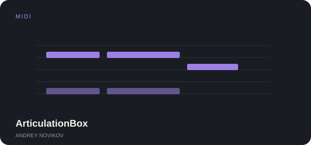

# ArticulationBox

**By Andrey Novikov** · [Все скрипты](../README_RU.md)

[**↓ Скачать пакет ZIP**](https://github.com/andreynovikov86-cmd/ReaScripts/raw/refs/heads/main/downloads/ArticulationBox.zip) · [Установить через ReaPack](../README_RU.md#установка-и-обновление-через-reapack)



Автор: **Andrey Novikov**.

[English](README.md) · **Русский**

Руководство по функциям: [на русском](USER_GUIDE_RU.md) · [English](USER_GUIDE.md). Краткая справка без интернета доступна через **Help** в полном меню скрипта.

Компактное меню артикуляций для MIDI-редактора REAPER. Интерфейс скрипта — на английском.

Один пакет включает основное поле, короткое меню у курсора и полное меню настроек. Поддерживаются ручные и автоматические keyswitch, переключение MIDI-каналов, индивидуальные банки треков, дефолтные артикуляции, сопровождение нот и защита высот keyswitch при транспонировании.

## Установка через ReaPack

Адрес репозитория для импорта:

```text
https://raw.githubusercontent.com/andreynovikov86-cmd/ReaScripts/main/index.xml
```

В REAPER: **Extensions > ReaPack > Import repositories** → вставьте адрес → **Browse packages** → найдите **ArticulationBox** → **Install** → **Apply**.

Требуются [js_ReaScriptAPI](https://github.com/juliansader/ReaExtensions) и [ReaImGui](https://github.com/cfillion/reaimgui) для окна параметров. Установите оба расширения отдельно через ReaPack и перезапустите REAPER.

## Первый запуск

Откройте MIDI-айтем. В **Actions > MIDI Editor** запустите `Articulation_Manager.lua`. Клавишу быстрого выбора назначьте на `Articulation_Quick_Menu.lua` в том же разделе. Для сопровождения переключателей основной скрипт должен оставаться запущенным.

Банки создаются через **Banks > New**. Если выбран Empty bank, команда **Add / Edit articulation** сначала предложит создать банк. Пункт **Default articulation** под Banks задаёт артикуляцию для нот без другого назначения. Автозапуск: **Settings > Run script on startup**. Сохраняйте проект, чтобы восстановить выбранные банки треков и назначения нот.

Личные банки, проекты и резервные копии пользователя в репозиторий не включены. При переходе с ручной установки на ReaPack перепривяжите горячие клавиши к экшнам новой установки.

Подробности: [инструкция](INSTALL_RU.txt). Сведения о стороннем коде: [THIRD_PARTY_NOTICES](THIRD_PARTY_NOTICES.txt).

## Окно артикуляции

Добавление и редактирование объединены в одно компактное окно с вариантами **Keyswitch**, **Channel**, **KS + Channel**, **Controller**, **Ending**. Нажатие клавиши MIDI-контроллера или клавиши пианоролла подставляет ноту и velocity keyswitch; значения можно поправить вручную. **Save & Next** позволяет создать несколько записей подряд. Размер окна меняется за края и запоминается. Строка Bank показывает банк назначения, список Articulation позволяет добавлять и редактировать записи, а Remove articulation удаляет запись. Список основного меню находится в Articulations; варианты одной KS note с разной velocity объединяются в подменю. Горячая клавиша открывает выбор напрямую.

**Before note start** и **After note start** задают срабатывание до начала музыкальной ноты или после него. Настройте Delay в миллисекундах и независимую KS velocity, например для окончания лупа после взятия аккорда. Длина keyswitch по-прежнему следует концу музыкальной ноты.

## Ручные переключатели

На строках артикуляций можно рисовать и редактировать MIDI-ноты вручную. Такие ноты не получают дефолтную артикуляцию. При выбранной дефолтной артикуляции ручной переключатель действует внутри нарисованной области, а для последующих нот возвращается дефолт. Если дефолт не выбран, последнее переключение действует до следующего переключателя или явного назначения на том же MIDI-канале.

Если отдельно изменить высоту, положение, длину или velocity автоматического keyswitch, он становится ручным. Его прежние автоматические привязки снимаются, а музыкальные ноты сохраняются. Перемещение музыкальных нот по-прежнему переносит их автоматические переключатели.

Разные переключатели на одном MIDI-канале не накладываются: более ранняя нота артикуляции автоматически сокращается до начала следующей. Музыкальные ноты сохраняют свою длину.

## Выпуск обновления

Измените код пакета, увеличьте `@version` и обновите `@changelog` в `ArticulationBox/Articulation_Manager.lua`. Сначала опубликуйте файлы, затем добавьте новую версию в общий `index.xml` репозитория ReaScripts со ссылками на полный SHA коммита. Сохраняйте прежние версии для отката.

## Лицензия

ArticulationBox распространяется по [лицензии MIT](LICENSE.md): разрешены использование, изменение и распространение, включая коммерческое, с сохранением предусмотренных лицензией уведомлений об авторстве и лицензии.

Для использованного кода Gridbox сохранены исходные авторство и MIT-лицензия в [THIRD_PARTY_NOTICES](THIRD_PARTY_NOTICES.txt). Оба уведомления включены в пакет ReaPack.

### Контроллеры

Pitch Bend и любой CC можно сохранить отдельно или вместе с артикуляцией. Подменю **Controller** появляется при наличии пресетов или контроллеров, которые можно сбросить. **Reset controllers** снимает контроллеры с выделенных нот, сохраняя артикуляции. Доступны вся нота, начало и конец ноты с запасом Before/After и значением сброса. Изначально выбран **None**; далее в списке идут Pitch Bend, Mod Wheel и Hold Pedal. Контроллеры следуют за нотами и участвуют в Undo/Redo. Подробности — в [руководстве](USER_GUIDE_RU.md).

### Ending

**Type → Ending** создаёт отдельный keyswitch у конца ноты. В меню Ending находятся только такие записи. Назначьте Open или Slap обычным способом, затем добавьте слайд из Ending. Смена основной артикуляции сохраняет окончание; Clear ending снимает его отдельно. Delay отсчитывается до отпускания ноты.

### Редактирование и быстродействие

Add / Edit можно оставлять открытым при перемещении и изменении длины нот: привязки продолжают работать. Во время предварительного просмотра в штатном окне Quantize Events автоматическая запись MIDI приостанавливается и возобновляется после его закрытия. Простое выделение, включая Command+A, не пересоздаёт переключатели; при неизменном MIDI проигрывание и прокрутка используют сохранённое состояние. Запись большой партии выполняется одним буфером с проверкой сохранности музыкальных нот.

## Переход из прежнего репозитория ArticulationBox

Существующие установки могут продолжать обновляться обычной синхронизацией: прежний индекс совместимости получает новые версии из ReaScripts. Переустановка для обновлений не нужна. Шаги ниже нужны только для перехода на установку из общего репозитория.

1. Остановите прежний экземпляр ArticulationBox. Если включён **Settings > Run script on startup**, отключите его перед переходом.
2. В ReaPack удалите пакет ArticulationBox из прежнего репозитория **Andrey Novikov**, затем установите **ArticulationBox** из **ReaScripts by Andrey Novikov** по адресу выше.
3. Назначьте горячие клавиши MIDI Editor новым установленным действиям. При необходимости включите автозапуск в новом экземпляре.

Банки треков и назначения нот остаются в проектах REAPER. Шаблоны банков и настройки используют прежние места хранения. В старом репозитории остаются история версий и автоматически обновляемый индекс совместимости; разработка ведётся здесь.
