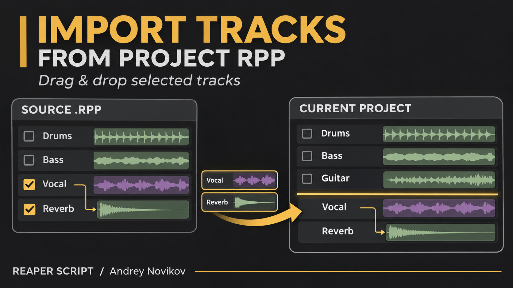
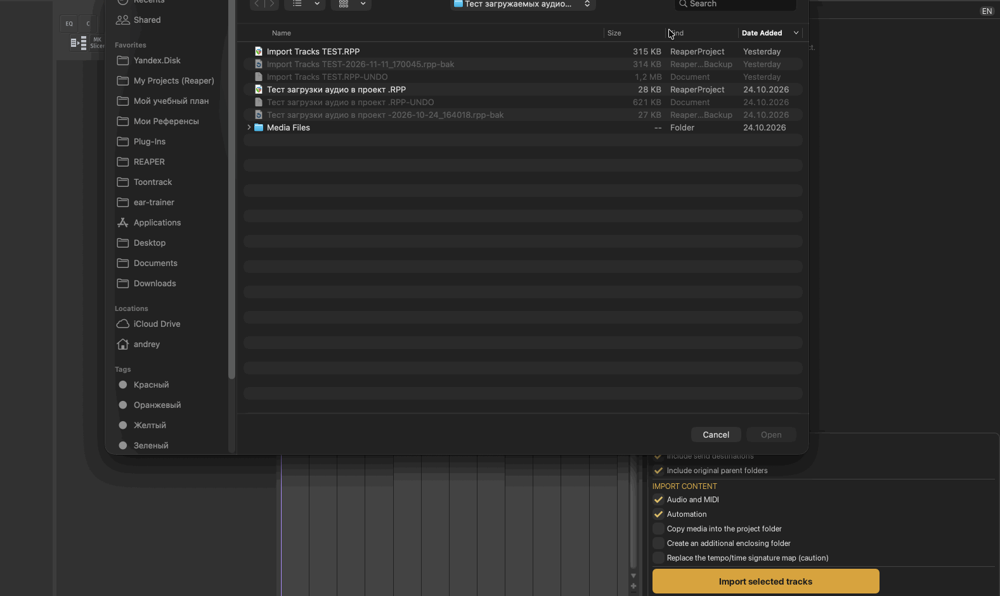

[English](README.md) | [Русский](README_RU.md)

# ReaScripts

REAPER Lua scripts by **Andrey Novikov**.

<details>
<summary>Install and update via ReaPack</summary>

1. Open **Extensions → ReaPack → Import repositories** and add:
   ```text
   https://raw.githubusercontent.com/andreynovikov86-cmd/ReaScripts/main/index.xml
   ```
2. Open **Extensions → ReaPack → Browse packages**. Search for **Explode Stereo Audio (Andrey Novikov)**, **Open Melodyne (Andrey Novikov)**, **Render Take FX and Bypass Originals FX (Andrey Novikov)** or **Import Tracks From Project RPP (Andrey Novikov)**, mark the desired package for installation, and click **Apply**.
3. For later releases, use **Extensions → ReaPack → Synchronize packages**.

Current versions: **Explode Stereo Audio 1.0.1**, **Open Melodyne 1.1.0** (one window per selection), **Render Take FX 1.2.1** and **Import Tracks From Project RPP 0.2.26**.

Scripts installed through ReaPack are registered in the main Action List with **(Andrey Novikov)** in their file names. If migrating from a manually downloaded script, assign the shortcut to the ReaPack action once; subsequent ReaPack updates keep that action and shortcut.

</details>

## 1. Render Take FX and Bypass Originals FX (Andrey Novikov)

[Download script](Andrey%20Novikov_Render%20Take%20FX%20and%20Bypass%20Originals%20FX.lua)

<details>
<summary>Description, installation and validation</summary>

A standalone Lua action for REAPER. It renders selected items to new audio takes with their active Take FX processing applied, then bypasses FX on the original takes. Original takes and plug-ins remain available.

- Mono audio takes render to mono; stereo audio takes render to stereo.
- Take channel modes Mono (downmix), Mono (left), and Mono (right) render to mono.
- MIDI takes and multichannel audio default to stereo output.
- Track FX are temporarily bypassed during rendering and then restored to their previous state, so their processing is excluded from the rendered audio.
- Item selection is restored. The edit uses one Undo step.
- No SWS, ReaPack, or other extensions required.

### Installation

Download `Andrey Novikov_Render Take FX and Bypass Originals FX.lua`. In REAPER, open **Actions → Show action list → New action → Load ReaScript** and select the downloaded file. Assign a shortcut if desired.

Select one or more items and run the action. The new rendered takes become active. To use an original take again, select it and re-enable its Take FX.

If a render is cancelled or fails, track FX states are restored and original Take FX are left unchanged. Any takes already rendered can be removed with Undo.

### Validation

Lua syntax and mocked REAPER API tests passed for mixed mono/stereo selections, mono channel mode, original Take FX bypass, track FX restoration, render cancellation, empty selection, and cleanup. Native audio rendering inside REAPER has not yet been verified.

</details>

## 2. Open Melodyne (Andrey Novikov)

[Download script](Andrey%20Novikov_Open%20Melodyne.lua)

<details>
<summary>Description and installation</summary>

Ensures an active Melodyne instance exists on every selected target, then opens only one floating Melodyne window for the whole selection.

- Selected items take priority: the action processes their active takes.
- If no items are selected, it processes selected tracks.
- Bypassed and offline instances are skipped and left unchanged.
- Searches inside FX containers, skipping bypassed and offline containers.
- Reuses an already open active Melodyne window among the selected targets; otherwise opens the first available instance.
- Closes other active Melodyne interfaces on the selected targets, including extra instances on the same target. Plug-ins remain loaded and processing.
- Windows outside the selection are left unchanged.

### Installation

Download the Lua file. In REAPER, open **Actions → Show action list → New action → Load ReaScript** and select the file. Assign a shortcut if desired.

Requires **REAPER 7.06+** and an installed Melodyne plug-in available in the FX Browser. No extensions required.

### Validation

Lua syntax and 12 mocked REAPER API scenarios passed: multiple tracks, repeated invocation, existing windows, duplicate instances, take priority, bypass/offline, containers, partial/total insertion failure, empty selection, and FX chain windows. Operation inside REAPER has not yet been verified.

</details>

## 3. Explode Stereo Audio (Andrey Novikov)

[Download script](Andrey%20Novikov_Explode%20Stereo%20Audio.lua)

<details>
<summary>Description and installation</summary>

Splits selected stereo items to independent mono WAV files. With no item selection, processes stereo items on selected tracks. Each source track becomes a folder containing exactly one shared L/R track pair for all its processed items. Named tracks become `Name - L` and `Name - R`; unnamed tracks use `L` and `R`. Children are panned fully left/right with a 0 dB pan law. Each resulting item pair has its own group.

Take FX are excluded from the new audio, copied to both resulting mono takes and bypassed, preserving plug-in settings. Track FX, automation and routing remain on the source folder. Source items are removed only after all extractions succeed; source files on disk remain intact. One Undo restores the project edit. Item grouping is enabled if needed; that global option remains enabled after Undo.

Requires REAPER 7.46+; no extensions. Output: mono WAV 32-bit float at the source sample rate. Processes single-take stereo files in Normal channel mode on tracks without fixed/free lanes; unsupported items stay in place. Add Melodyne to the resulting L/R tracks for independent source analysis. Existing ARA analysis migration has not been verified.

Verified in isolated REAPER 7.84/macOS-arm64: multiple items/tracks, shared L/R, naming, folder nesting, groups, copied/bypassed Take FX parameters, Undo/Redo, format restoration, and early/late render failure rollback. Inspected 22 mono float32 WAV files; six channel comparisons, including active source Take FX, matched the corresponding trimmed raw source samples exactly.

### Installation

Use **Extensions → ReaPack → Synchronize packages** to update. For a first installation, find **Explode Stereo Audio (Andrey Novikov)** in **Browse packages**, mark it for installation and click **Apply**.

For manual installation, download the Lua file and use **Actions → Show action list → New action → Load ReaScript**.

Version 1.0.1 corrects the name and capitalization. After updating, an existing shortcut may need to be assigned once to the renamed action.

[Guide](docs/explode-stereo-audio.md)

</details>

## 4. Import Tracks From Project RPP (Andrey Novikov)

[Download script](Andrey%20Novikov_Import%20Tracks%20From%20Project%20RPP.lua)



<details>
<summary>Description, installation and validation</summary>

Import selected tracks from a saved `.RPP` without opening the source project. Includes a folder tree, search, manual dependency exclusions, automatic parent selection and direct send destinations. Imports items, FX, settings, envelopes and routing between included tracks.

Add the checked set with the Import button or drag it to a position in the arrange view. The yellow line marks the insertion boundary. Options include media copying with progress, an enclosing folder and optional tempo-map replacement. RU/EN interface, Esc to close, and a separate remembered source file for each destination project.

Requires **REAPER 7.85+** and **ReaImGui 0.10+**. Dragging also requires **js_ReaScriptAPI**. Track parameter/VCA grouping and hardware outputs are omitted. Undo restores project edits; copied files remain on disk.

Installation: synchronize ReaPack, find **Import Tracks From Project RPP (Andrey Novikov)** in **Browse packages**, and click **Apply**. Manual installation: load the downloaded Lua file through **Actions → Show action list → New action → Load ReaScript**.

Verified in REAPER 7.85/macOS-arm64: insertion, folders, automation lanes, copying and Undo; isolated checks cover search, keyboard, notices and source history. The full mouse gesture and other platforms have not been fully verified.



[Guide and screenshots](docs/import-tracks-from-project.md)

</details>

<details>
<summary>Publishing future updates (maintainers)</summary>

Keep the repository URL, category, package name and installed file name in `index.xml` stable. For every release, increase the script's `@version`, update `@changelog`, and commit the script first. Add a new matching `<version>` to that package in `index.xml`, pointing its source URL to the full source commit SHA. Keep previous versions for rollback. Publish the updated index to `main`; ReaPack synchronization will then offer the new version. Changing only the Lua file does not publish a ReaPack update.

</details>
