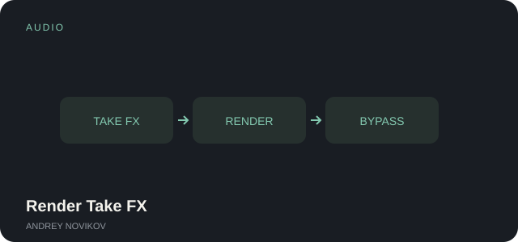
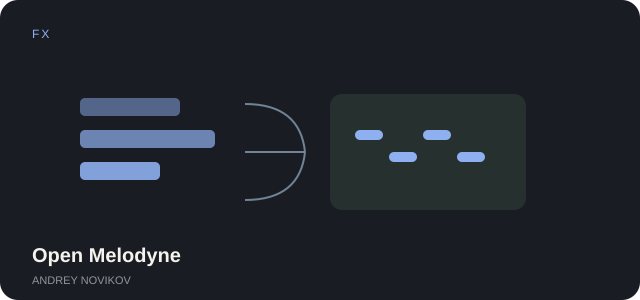
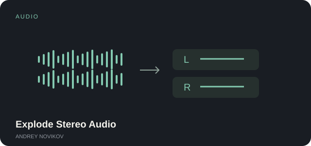
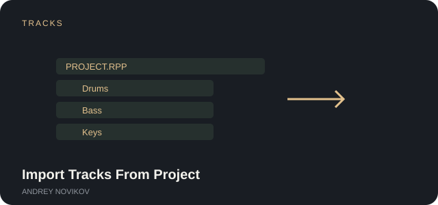
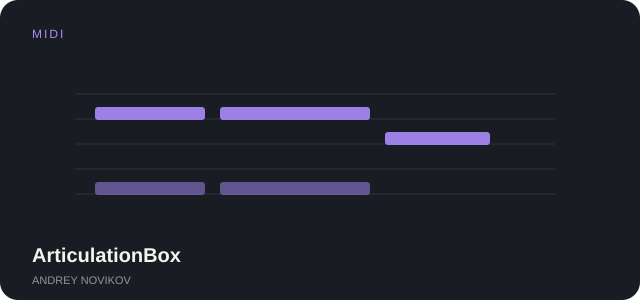

[English](README.md) · [Русский](README_RU.md)

# ReaScripts

[**Open the visual catalog ↗**](https://andreynovikov86-cmd.github.io/ReaScripts/#/scripts)

Free tools for REAPER. By **Andrey Novikov**.

## Install & update via ReaPack

> [!IMPORTANT]
> One repository for every script. Add this URL in **Extensions → ReaPack → Import repositories**.

```text
https://raw.githubusercontent.com/andreynovikov86-cmd/ReaScripts/main/index.xml
```

Find a script in **Browse packages → Install → Apply**. For updates, use **Synchronize packages**.

## Browse scripts

Select a cover or a name for details, screenshots, download and installation.

<table>
<tr>
<td width="50%" valign="top"><a href="docs/render-take-fx.md"><br/><strong>Render Take FX</strong></a><br/>Render Take FX to a new take and bypass the originals.</td>
<td width="50%" valign="top"><a href="docs/open-melodyne.md"><br/><strong>Open Melodyne</strong></a><br/>Prepare Melodyne for a selection and open one window.</td>
</tr>
<tr>
<td width="50%" valign="top"><a href="docs/explode-stereo-audio.md"><br/><strong>Explode Stereo Audio</strong></a><br/>Split stereo items into independent mono left and right files.</td>
<td width="50%" valign="top"><a href="docs/import-tracks-from-project.md"><br/><strong>Import Tracks From Project</strong></a><br/>Browse another project and import the tracks you need.</td>
</tr>
<tr>
<td width="50%" valign="top"><a href="ArticulationBox/README.md"><br/><strong>ArticulationBox</strong></a><br/>Manage MIDI articulations, controllers and note endings.</td>
<td></td></tr>
</table>
