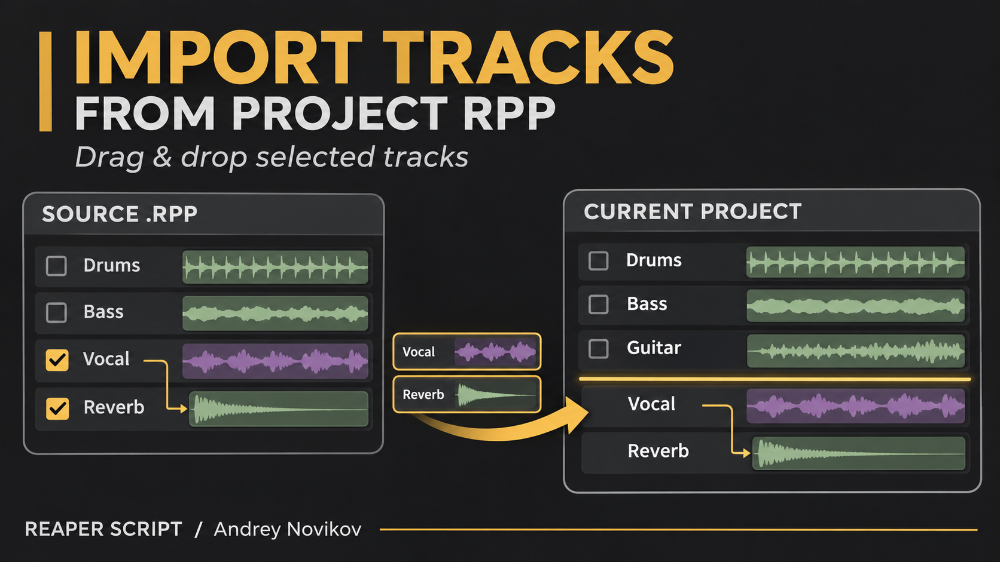
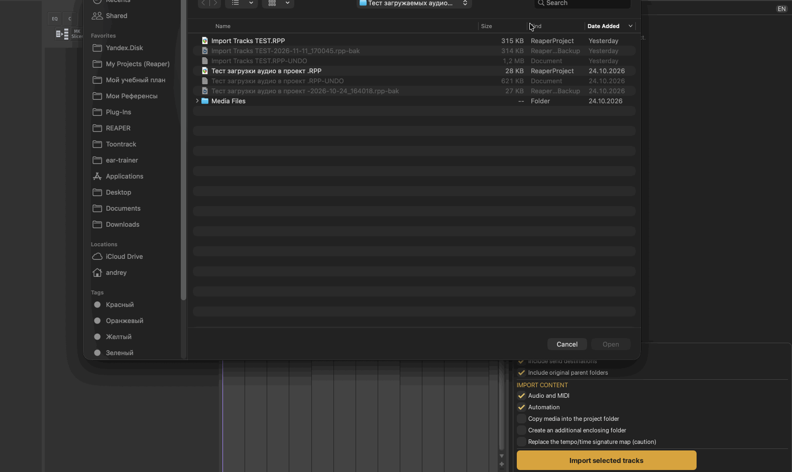

[English](README.md) | [Русский](README_RU.md)

# ReaScripts

Lua-скрипты для REAPER. Автор: **Andrey Novikov (Андрей Новиков)**.

<details>
<summary>Установка и обновление через ReaPack</summary>

1. Откройте **Extensions → ReaPack → Import repositories** и добавьте:
   ```text
   https://raw.githubusercontent.com/andreynovikov86-cmd/ReaScripts/main/index.xml
   ```
2. Откройте **Extensions → ReaPack → Browse packages**. Найдите **Explode Stereo Audio (Andrey Novikov)**, **Open Melodyne (Andrey Novikov)**, **Render Take FX and Bypass Originals FX (Andrey Novikov)** или **Import Tracks From Project RPP (Andrey Novikov)**, отметьте нужный пакет для установки и нажмите **Apply**.
3. В дальнейшем обновляйте через **Extensions → ReaPack → Synchronize packages**.

Текущие версии: **Explode Stereo Audio 1.0.1**, **Open Melodyne 1.1.0** (одно окно на всё выделение), **Render Take FX 1.2.1** и **Import Tracks From Project RPP 0.2.26**.

Установленные через ReaPack скрипты появляются в основном списке Actions с **(Andrey Novikov)** в имени файла. При переходе с вручную скачанного скрипта один раз назначьте горячую клавишу действию из ReaPack. Последующие обновления сохраняют это действие и клавишу.

</details>

## 1. Render Take FX and Bypass Originals FX (Andrey Novikov) — рендер Take FX

[Скачать скрипт](Andrey%20Novikov_Render%20Take%20FX%20and%20Bypass%20Originals%20FX.lua)

<details>
<summary>Описание, установка и проверка</summary>

Скрипт рендерит выделенные айтемы с обработкой Take FX в новые тейки и отключает плагины на исходных активных тейках. Моно сохраняется в моно, стерео — в стерео. Обработка трековых FX не включается в рендер; их состояние после выполнения восстанавливается.

Установка: скачайте Lua-файл, откройте **Actions → Show action list → New action → Load ReaScript** и выберите его. Выделите айтемы и запустите экшн. Для возврата к исходному звуку переключитесь на исходный тейк и включите его Take FX. Все изменения можно отменить одним Undo.


Моно-режимы тейка (downmix, left, right) рендерятся в моно. MIDI и многоканальное аудио по умолчанию рендерятся в стерео. Дополнительные расширения не требуются.

Если рендер отменён или завершился ошибкой, состояние трековых FX восстанавливается, а FX исходных тейков остаются в прежнем состоянии. Уже созданные тейки можно убрать через Undo.

### Проверка

Проверены синтаксис Lua и логика на имитации REAPER API: смешанное выделение моно/стерео, моно-режим канала, байпас исходных Take FX, восстановление трековых FX, отмена рендера, пустое выделение и завершение операции. Рендер аудио в самом REAPER ещё не проверен.

</details>

## 2. Open Melodyne (Andrey Novikov) — открыть Melodyne

[Скачать скрипт](Andrey%20Novikov_Open%20Melodyne.lua)

<details>
<summary>Описание и установка</summary>

Проверяет наличие активного Melodyne на каждом выбранном объекте и при необходимости добавляет его. Для всего выделения открывает только одно окно Melodyne.

- Если выделены айтемы, работает с их активными тейками.
- Если айтемы не выделены, работает с выделенными треками.
- Экземпляры в байпасе или оффлайне пропускает, оставляя их состояние без изменений.
- Ищет также внутри FX-контейнеров. Контейнеры в байпасе или оффлайне пропускает.
- Если среди выбранных объектов уже открыт активный Melodyne, использует его окно. Иначе открывает первый доступный экземпляр.
- Закрывает остальные интерфейсы активного Melodyne на выбранных объектах, в том числе у дополнительных экземпляров на одном объекте. Сами плагины продолжают работать.
- Окна вне выделения остаются без изменений.

### Установка

Скачайте Lua-файл. В REAPER откройте **Actions → Show action list → New action → Load ReaScript** и выберите файл. При желании назначьте горячую клавишу.

Нужны **REAPER 7.06+** и установленный Melodyne, доступный в FX Browser. Дополнительные расширения не требуются.

### Проверка

Проверены синтаксис Lua и 12 сценариев на имитации REAPER API: несколько треков, повторный запуск, уже открытые окна, несколько экземпляров, приоритет тейков, байпас/оффлайн, контейнеры, частичная и полная ошибка добавления, пустое выделение и окна FX-цепочек. Работа в самом REAPER пока не проверена.

</details>

## 3. Explode Stereo Audio (Andrey Novikov) — стерео в два моно

[Скачать скрипт](Andrey%20Novikov_Explode%20Stereo%20Audio.lua)

<details>
<summary>Описание и установка</summary>

Создаёт отдельные физические монофайлы L и R. Исходная дорожка становится папкой с одной общей парой дочерних дорожек для всех её обрабатываемых айтемов. Названия: `Название - L` и `Название - R`; при пустом имени — просто `L` и `R`. Панорама — 100% L/R, закон панорамирования дочерних дорожек — 0 dB. Каждая пара айтемов получает собственную группу.

Выделенные айтемы имеют приоритет. Если айтемы не выделены, обрабатываются стереоайтемы выбранных дорожек. Take FX не включаются в новые файлы: их цепочки копируются на оба монотейка в байпасе с сохранением настроек. Трековые FX, автоматизация и маршрутизация остаются на исходной папке. Исходные обработанные айтемы удаляются из проекта только после успешного разделения; файлы на диске не удаляются. Один Undo отменяет изменения проекта. Группировка айтемов включается при необходимости; эта глобальная настройка остаётся включённой после Undo.

REAPER 7.46+, расширения не нужны. Результат — моно WAV 32-bit float с частотой исходника. Нужны файловые стереоисточники, один тейк, Normal channel mode, дорожки без fixed/free lanes. Неподходящие айтемы остаются на месте. Для раздельного анализа добавляйте Melodyne на дочерние L/R; перенос прежнего ARA-анализа отдельно не проверялся.

Проверено в отдельном REAPER 7.84/macOS-arm64: несколько файлов/треков, общие L/R, названия, папки, группы, перенос Take FX в байпасе и сохранение параметров, Undo/Redo, восстановление формата и откат при ранней/поздней ошибке. Проверены 22 моно WAV 32-bit float; шесть поканальных сравнений с исходником, включая айтемы с активными Take FX, дали нулевую погрешность.

### Установка

Обновление: **Extensions → ReaPack → Synchronize packages**. Для первой установки найдите **Explode Stereo Audio (Andrey Novikov)** в **Browse packages**, отметьте пакет для установки и нажмите **Apply**.

Ручная установка: скачайте Lua-файл и выберите его через **Actions → Show action list → New action → Load ReaScript**.

Версия 1.0.1 исправляет название и регистр букв. После обновления ранее назначенную клавишу может потребоваться один раз переназначить новому имени действия.

[Инструкция](docs/explode-stereo-audio_RU.md)

</details>

## 4. Import Tracks From Project RPP (Andrey Novikov) — импорт дорожек

[Скачать скрипт](Andrey%20Novikov_Import%20Tracks%20From%20Project%20RPP.lua)



<details>
<summary>Описание, установка и проверка</summary>

Импорт выбранных дорожек из сохранённого `.RPP` без открытия исходного проекта. Дерево папок, поиск, ручное исключение зависимостей, автоматический выбор родителей и прямых посылов. Импортируются айтемы, FX, настройки, огибающие и связи между включёнными дорожками.

Можно добавить отмеченный набор кнопкой или перетащить его в нужное место аранжировки. Жёлтая линия показывает границу вставки. Доступны копирование медиа с прогрессом, дополнительная общая папка и необязательная замена карты темпа. Интерфейс RU/EN, закрытие Esc, память исходного файла отдельно для каждого текущего проекта.

Требуются **REAPER 7.85+** и **ReaImGui 0.10+**. Для перетаскивания дополнительно нужен **js_ReaScriptAPI**. Группировка параметров/VCA и аппаратные выходы не импортируются. Undo отменяет изменения проекта; скопированные файлы остаются на диске.

Установка: синхронизируйте ReaPack, найдите **Import Tracks From Project RPP (Andrey Novikov)** в **Browse packages** и нажмите **Apply**. Вручную: загрузите скачанный Lua-файл через **Actions → Show action list → New action → Load ReaScript**.

Проверены в REAPER 7.85/macOS-arm64 вставка, папки, полосы автоматизации, копирование и Undo; отдельно — поиск, клавиатура, уведомления и память источников. Полный жест мышью и другие платформы проверены не полностью.



[Руководство и скриншоты](docs/import-tracks-from-project_RU.md)

</details>

<details>
<summary>Публикация следующих обновлений (для автора)</summary>

Сохраняйте URL репозитория, категорию, имя пакета и установленного файла в `index.xml`. Для каждого выпуска повышайте `@version` скрипта, обновляйте `@changelog` и сначала публикуйте коммит со скриптом. Затем добавляйте в `index.xml` новую запись `<version>` этого пакета со ссылкой на полный SHA коммита исходника. Старые версии сохраняйте для отката. После публикации обновлённого индекса в `main` ReaPack предложит новую версию при синхронизации. Изменения только Lua-файла для выпуска обновления недостаточно.

</details>
