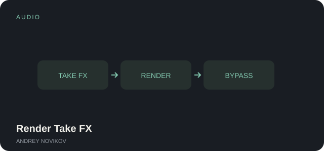
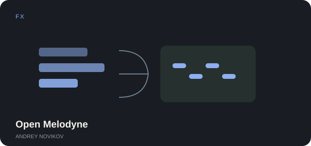
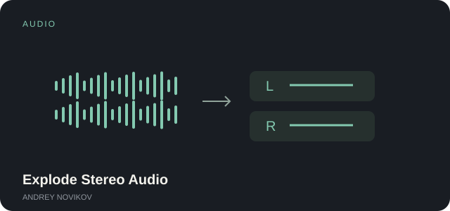
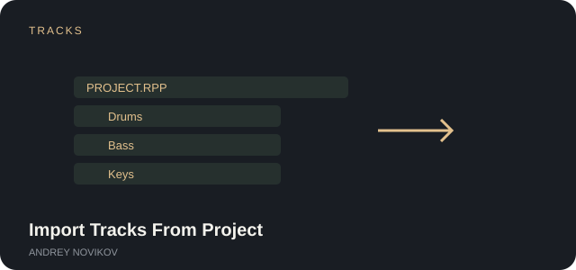
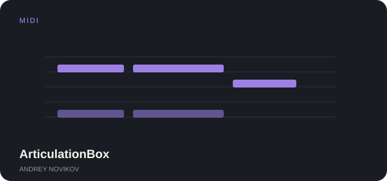

[English](README.md) · [Русский](README_RU.md)

# ReaScripts

[**Открыть визуальный каталог ↗**](https://andreynovikov86-cmd.github.io/ReaScripts/#/scripts)

Бесплатные инструменты для REAPER. Автор: **Andrey Novikov**.

## Установка и обновление через ReaPack

> [!IMPORTANT]
> Одна ссылка для установки и обновления всех скриптов. Добавьте её в **Extensions → ReaPack → Import repositories**.

```text
https://raw.githubusercontent.com/andreynovikov86-cmd/ReaScripts/main/index.xml
```

Найдите нужный скрипт в **Browse packages → Install → Apply**. Для обновлений — **Synchronize packages**.

## Каталог

Нажмите на обложку или название: откроются описание, скриншоты, скачивание и установка.

<table>
<tr>
<td width="50%" valign="top"><a href="docs/render-take-fx_RU.md"><br/><strong>Render Take FX</strong></a><br/>Рендер обработки в новый тейк с отключением исходных Take FX.</td>
<td width="50%" valign="top"><a href="docs/open-melodyne_RU.md"><br/><strong>Open Melodyne</strong></a><br/>Подготовка Melodyne на выделении с одним открытым окном.</td>
</tr>
<tr>
<td width="50%" valign="top"><a href="docs/explode-stereo-audio_RU.md"><br/><strong>Explode Stereo Audio</strong></a><br/>Разделение стереоайтемов на отдельные монофайлы L и R.</td>
<td width="50%" valign="top"><a href="docs/import-tracks-from-project_RU.md"><br/><strong>Import Tracks From Project</strong></a><br/>Просмотр другого проекта и импорт нужных дорожек.</td>
</tr>
<tr>
<td width="50%" valign="top"><a href="ArticulationBox/README_RU.md"><br/><strong>ArticulationBox</strong></a><br/>Артикуляции MIDI, контроллеры и независимые окончания нот.</td>
<td></td></tr>
</table>
