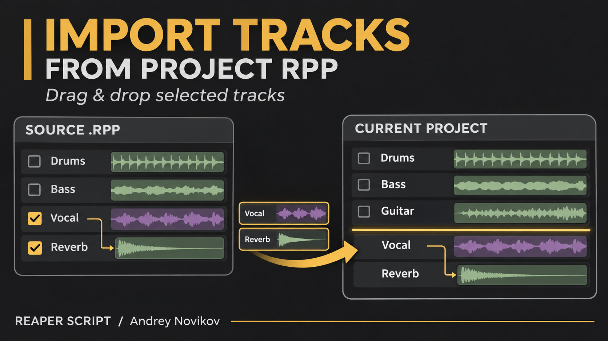
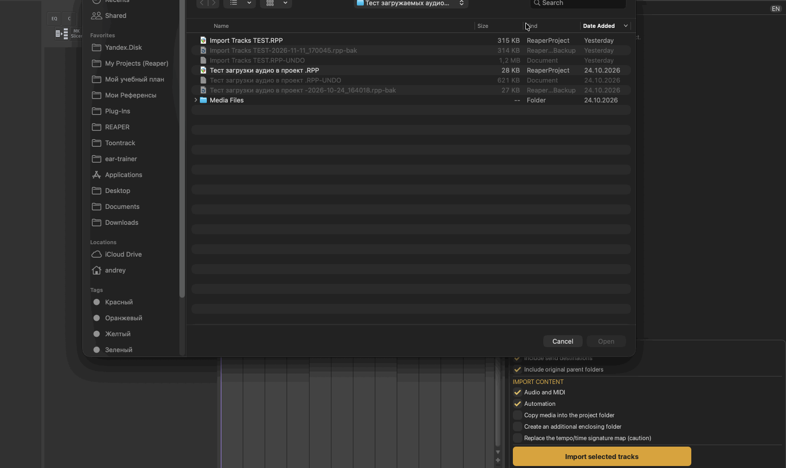
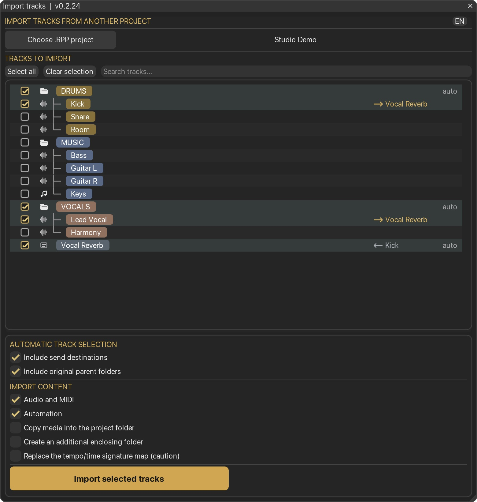
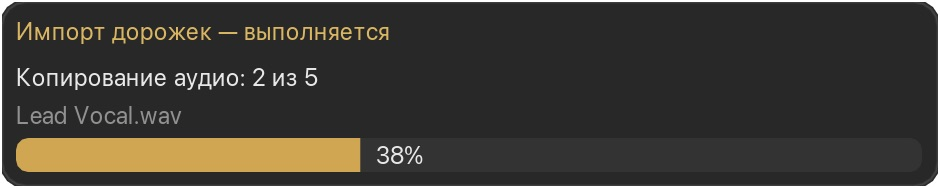

# Import Tracks From Project RPP

[English](import-tracks-from-project.md) | [Русский](import-tracks-from-project_RU.md)

Author: **Andrey Novikov**. Version **0.2.26**. Requires **REAPER 7.85+** and **ReaImGui 0.10+**. Dragging into the arrange view also requires **js_ReaScriptAPI**.

Import selected tracks from another saved REAPER project without opening it in a project tab or modifying its file. Browse its track tree, search by name, choose the tracks and import their items, FX, settings and routing between included tracks.







## Usage

1. Run **Import Tracks From Project RPP (Andrey Novikov)** and choose the source `.RPP`.
2. Check the tracks you need. Selecting a folder includes its subtree. Automatic selection can also include parent folders and direct send destinations; individual dependencies can be excluded manually.
3. Click **Import selected tracks** to add new tracks at the end of the current project. Alternatively, drag a row into REAPER's arrange view or track panel. The yellow line indicates the insertion boundary.
4. Dragging a checked row carries the current checked set. Dragging an unchecked row starts a fresh selection: that track plus send destinations and parent folders enabled in the import settings. Earlier manual exclusions are ignored for this drag. The visible checked set is preserved.

A drop always creates new tracks; it does not merge the source into an existing track. Without `js_ReaScriptAPI`, selection and the Import button still work.

The first file selection starts in the current project's folder. Each saved destination project remembers its own last source `.RPP`. An unsaved destination uses the last source folder. Use **RU/EN** in the header to switch languages; the choice is remembered.

The search field has a clear button on its left, inside the field. It is gray and disabled when the field is empty and becomes active when text is present. Clicking a search result's name reveals the same track in the full tree. **Esc** closes the browser; during a drag, Esc cancels that drag. An assigned action shortcut can also toggle the window, with text editing taking priority while the search field is active.

## Import options

- **Audio and MIDI:** include source items and takes. Track FX and track settings are retained.
- **Automation:** include track, take and FX envelope blocks.
- **Copy media into the project folder:** copy referenced media into `Imported Media` beside the destination `.RPP`. Save the destination project first. Existing filenames are preserved by giving new copies unique suffixes.
- **Create an additional enclosing folder:** place the imported tracks inside a new folder named after the source project.
- **Replace the tempo/time signature map:** replace the destination map with the saved source map after confirmation. This option is off by default and can affect existing items' positions.



Copying is processed in chunks with a progress window. Insertion and plug-in loading have a separate status. A slow native plug-in load can temporarily pause animation.

Media paths are resolved relative to the source project. If an old absolute path no longer exists, the script checks predictable media locations beside that source project, including its saved recording directory. Ambiguous matches are not silently substituted.

## Installation through ReaPack

Install **ReaImGui 0.10+** via ReaPack. Install **js_ReaScriptAPI** as well if you want to drag tracks into the arrange view.

If **ReaScripts by Andrey Novikov** is already connected:

1. Open **Extensions → ReaPack → Synchronize packages**.
2. Open **Extensions → ReaPack → Browse packages** and search for `Import Tracks From Project RPP`.
3. Mark the package for installation and click **Apply**.

For a first installation, add this URL through **Extensions → ReaPack → Import repositories**:

```text
https://raw.githubusercontent.com/andreynovikov86-cmd/ReaScripts/main/index.xml
```

Manual installation: download [the Lua script](../Andrey%20Novikov_Import%20Tracks%20From%20Project%20RPP.lua), then open **Actions → Show action list → New action → Load ReaScript** and select it. Assign a shortcut if desired. No particular shortcut is required or installed automatically.

When switching from a manually installed development version to ReaPack, assign the shortcut to the ReaPack action once. Avoid keeping both actions active; future ReaPack updates retain the installed filename and action.

## Scope and limitations

- The browser reads the **saved `.RPP` file**. Save source edits before importing.
- Only routing between included tracks is remapped. Automatic send selection includes direct destinations, not their entire downstream bus graph.
- Track parameter/VCA grouping and hardware outputs are not imported. Imported tracks are disarmed for recording.
- Available source plug-ins are needed to reproduce the processing. Plug-in compatibility, ARA state migration and external resources stored inside plug-ins are not verified separately.
- One Undo restores project edits. Copied media files remain on disk so Redo can use them.

## Validation

Tested with REAPER **7.85 on macOS arm64**: parsing source projects, moved-media recovery, insertion at the start/end and after a collapsed folder, uneven track heights, separate automation lanes, media copying, byte-for-byte copy verification and Undo. Keyboard behavior, bilingual notices, remembered source locations and media-copy error handling also have isolated checks. UI colors and the progress/notice windows were inspected in REAPER.

The complete mouse drag gesture and other operating systems/multi-monitor HiDPI configurations have not been fully verified. Test on a copy of the destination project before relying on the script in a session.
