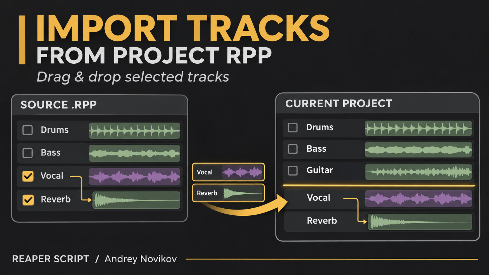
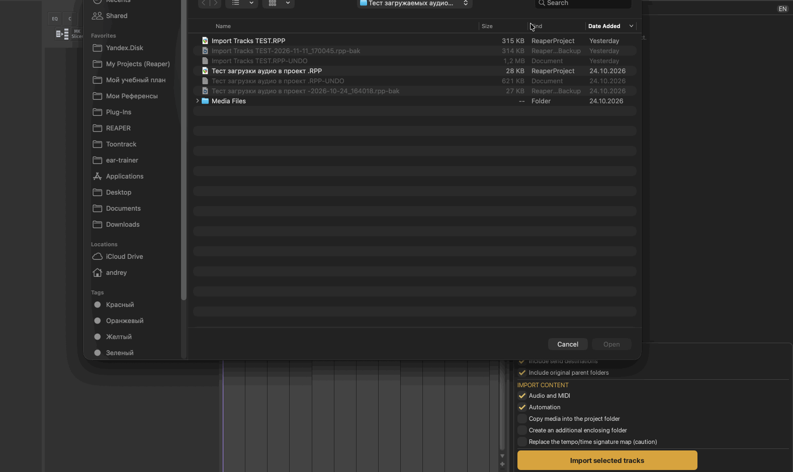
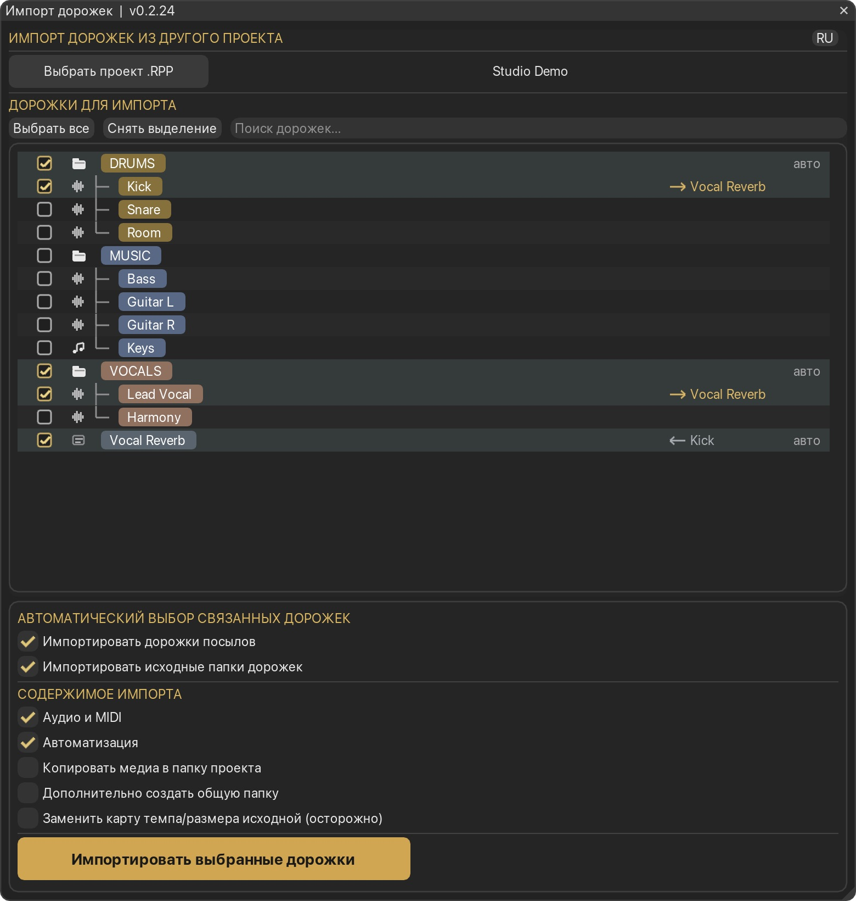
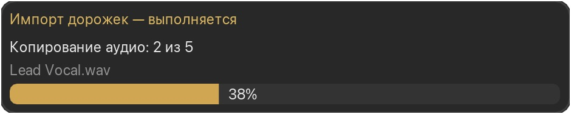

# Import Tracks From Project RPP

[English](import-tracks-from-project.md) | [Русский](import-tracks-from-project_RU.md)

Автор: **Andrey Novikov (Андрей Новиков)**. Версия **0.2.26**. Требуются **REAPER 7.85+** и **ReaImGui 0.10+**. Для перетаскивания в аранжировку дополнительно нужен **js_ReaScriptAPI**.

Импорт выбранных дорожек из сохранённого проекта REAPER без открытия его в отдельной вкладке и без изменения исходного файла. Скрипт показывает дерево дорожек, позволяет искать их по имени и переносить айтемы, FX, настройки и связи между включёнными дорожками.







## Использование

1. Запустите **Import Tracks From Project RPP (Andrey Novikov)** и выберите исходный `.RPP`.
2. Отметьте нужные дорожки. Выбор папки включает её содержимое. Автоматический выбор может добавить родительские папки и прямые назначения посылов; отдельные зависимости можно исключить вручную.
3. Нажмите **Импортировать выбранные дорожки**, чтобы добавить новые дорожки в конец текущего проекта. Либо перетащите строку в аранжировку или панель дорожек REAPER. Жёлтая линия показывает границу вставки.
4. Перетаскивание отмеченной строки переносит весь отмеченный набор. Перетаскивание неотмеченной строки начинает новый выбор: эта дорожка плюс посылы и родительские папки по настройкам импорта. Предыдущие ручные исключения для этого переноса не учитываются. Галочки в списке сохраняются.

При сбросе всегда создаются новые дорожки. Содержимое не объединяется с существующей дорожкой. Без `js_ReaScriptAPI` работают выбор дорожек и кнопка импорта.

При первом выборе открывается папка текущего проекта. Для каждого сохранённого проекта отдельно запоминается последний исходный `.RPP`. Для несохранённого проекта используется последняя папка источника. Язык переключается кнопкой **RU/EN** в заголовке и сохраняется между запусками.

Крестик очистки находится слева внутри строки поиска. Без текста он серый и неактивный; при вводе текста становится активным. Нажатие на имя найденной дорожки показывает её в полном дереве. **Esc** закрывает окно; во время переноса Esc отменяет перенос. Окно можно переключать назначенной горячей клавишей, а при редактировании строки поиска приоритет остаётся у ввода текста.

## Параметры импорта

- **Аудио и MIDI:** импорт айтемов и тейков. Трековые FX и настройки дорожек сохраняются.
- **Автоматизация:** импорт блоков огибающих дорожек, тейков и FX.
- **Копировать медиа в папку проекта:** копирование используемых файлов в `Imported Media` рядом с целевым `.RPP`. Сначала сохраните текущий проект. Если такое имя уже занято, новая копия получает уникальный суффикс.
- **Дополнительно создать общую папку:** импортированный набор помещается в новую папку с названием исходного проекта.
- **Заменить карту темпа/размера исходной:** замена карты текущего проекта после подтверждения. По умолчанию отключено; изменение карты может повлиять на положение существующих айтемов.



Копирование выполняется порциями и сопровождается окном прогресса. Вставка дорожек и загрузка эффектов показываются отдельным этапом. Во время медленного вызова загрузки плагина анимация может временно приостановиться.

Относительные пути к медиа разрешаются от папки исходного проекта. Если старый абсолютный путь больше не существует, проверяются ожидаемые папки медиа рядом с этим проектом, включая сохранённую папку записи. При неоднозначном совпадении файл не подставляется автоматически.

## Установка через ReaPack

Установите **ReaImGui 0.10+** через ReaPack. Для перетаскивания в аранжировку также установите **js_ReaScriptAPI**.

Если **ReaScripts by Andrey Novikov** уже подключён:

1. Откройте **Extensions → ReaPack → Synchronize packages**.
2. В **Extensions → ReaPack → Browse packages** найдите `Import Tracks From Project RPP`.
3. Отметьте пакет для установки и нажмите **Apply**.

При первом подключении добавьте адрес через **Extensions → ReaPack → Import repositories**:

```text
https://raw.githubusercontent.com/andreynovikov86-cmd/ReaScripts/main/index.xml
```

Ручная установка: скачайте [Lua-скрипт](../Andrey%20Novikov_Import%20Tracks%20From%20Project%20RPP.lua), откройте **Actions → Show action list → New action → Load ReaScript** и выберите файл. При желании назначьте горячую клавишу. Конкретная клавиша не требуется и автоматически не назначается.

При переходе с вручную установленной версии на ReaPack один раз переназначьте клавишу на действие из ReaPack. Не запускайте одновременно обе копии; следующие обновления ReaPack сохраняют имя установленного файла и действие.

## Возможности и ограничения

- Скрипт читает **сохранённый файл `.RPP`**. Перед импортом сохраните изменения исходного проекта.
- Переназначаются связи между включёнными дорожками. Автоматический выбор посылов добавляет прямые назначения, а не всю цепочку последующих шин.
- Группировка параметров дорожек/VCA и аппаратные выходы не импортируются. На добавленных дорожках отключается готовность к записи.
- Для воспроизведения обработки нужны исходные плагины. Совместимость конкретных плагинов, перенос состояния ARA и внешние ресурсы внутри плагинов отдельно не проверялись.
- Одно Undo отменяет изменения проекта. Скопированные медиафайлы остаются на диске для работы Redo.

## Проверка

Проверено в REAPER **7.85 на macOS arm64**: чтение исходных проектов, поиск перемещённых медиа, вставка в начало/конец и после свёрнутой папки, дорожки разной высоты, отдельные полосы автоматизации, копирование медиа, побайтовое совпадение копии и Undo. Отдельные проверки покрывают клавиатуру, уведомления на двух языках, память источников и ошибки копирования. Палитра, окна прогресса и уведомлений осмотрены в REAPER.

Полный жест перетаскивания мышью, другие операционные системы и конфигурации HiDPI с несколькими мониторами проверены не полностью. Перед использованием в рабочей сессии попробуйте импорт на копии целевого проекта.
