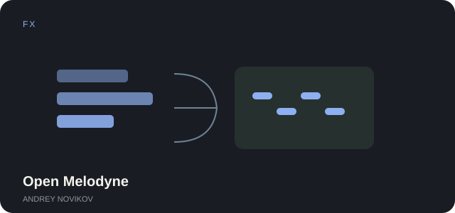

# Open Melodyne

**By Andrey Novikov** · [Все скрипты](../README_RU.md)

[**↓ Скачать скрипт**](https://raw.githubusercontent.com/andreynovikov86-cmd/ReaScripts/main/Andrey%20Novikov_Open%20Melodyne.lua) · [Установить через ReaPack](../README_RU.md#установка-и-обновление-через-reapack)

Проверяет наличие активного Melodyne на каждом выбранном объекте и при необходимости добавляет его. Для всего выделения открывает только одно окно Melodyne.

- Если выделены айтемы, работает с их активными тейками.
- Если айтемы не выделены, работает с выделенными треками.
- Экземпляры в байпасе или оффлайне пропускает, оставляя их состояние без изменений.
- Ищет также внутри FX-контейнеров. Контейнеры в байпасе или оффлайне пропускает.
- Если среди выбранных объектов уже открыт активный Melodyne, использует его окно. Иначе открывает первый доступный экземпляр.
- Закрывает остальные интерфейсы активного Melodyne на выбранных объектах, в том числе у дополнительных экземпляров на одном объекте. Сами плагины продолжают работать.
- Окна вне выделения остаются без изменений.

### Установка

Скачайте Lua-файл. В REAPER откройте **Actions → Show action list → New action → Load ReaScript** и выберите файл. При желании назначьте горячую клавишу.

Нужны **REAPER 7.06+** и установленный Melodyne, доступный в FX Browser. Дополнительные расширения не требуются.

### Проверка

Проверены синтаксис Lua и 12 сценариев на имитации REAPER API: несколько треков, повторный запуск, уже открытые окна, несколько экземпляров, приоритет тейков, байпас/оффлайн, контейнеры, частичная и полная ошибка добавления, пустое выделение и окна FX-цепочек. Работа в самом REAPER пока не проверена.
