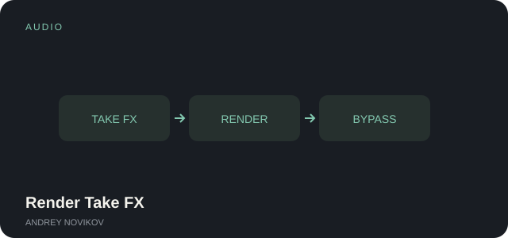

# Render Take FX and Bypass Originals FX

**By Andrey Novikov** · [Все скрипты](../README_RU.md)

[**↓ Скачать скрипт**](https://raw.githubusercontent.com/andreynovikov86-cmd/ReaScripts/main/Andrey%20Novikov_Render%20Take%20FX%20and%20Bypass%20Originals%20FX.lua) · [Установить через ReaPack](../README_RU.md#установка-и-обновление-через-reapack)

Скрипт рендерит выделенные айтемы с обработкой Take FX в новые тейки и отключает плагины на исходных активных тейках. Моно сохраняется в моно, стерео — в стерео. Обработка трековых FX не включается в рендер; их состояние после выполнения восстанавливается.

Установка: скачайте Lua-файл, откройте **Actions → Show action list → New action → Load ReaScript** и выберите его. Выделите айтемы и запустите экшн. Для возврата к исходному звуку переключитесь на исходный тейк и включите его Take FX. Все изменения можно отменить одним Undo.

Моно-режимы тейка (downmix, left, right) рендерятся в моно. MIDI и многоканальное аудио по умолчанию рендерятся в стерео. Дополнительные расширения не требуются.

Если рендер отменён или завершился ошибкой, состояние трековых FX восстанавливается, а FX исходных тейков остаются в прежнем состоянии. Уже созданные тейки можно убрать через Undo.

### Проверка

Проверены синтаксис Lua и логика на имитации REAPER API: смешанное выделение моно/стерео, моно-режим канала, байпас исходных Take FX, восстановление трековых FX, отмена рендера, пустое выделение и завершение операции. Рендер аудио в самом REAPER ещё не проверен.
